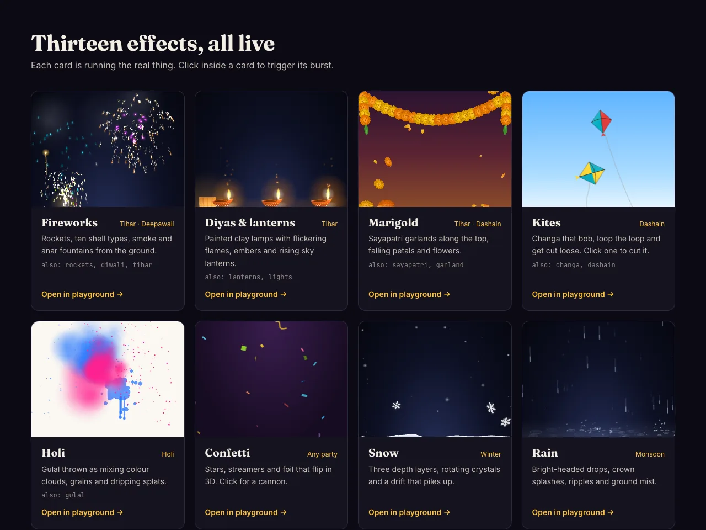
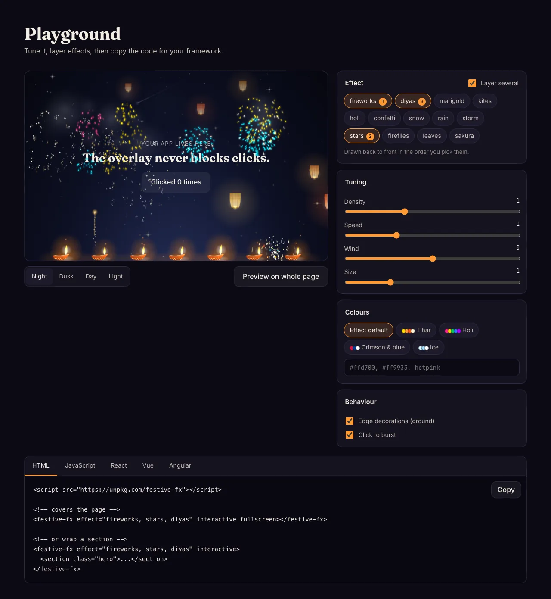

# festive-fx

[](https://shresthadeepesh.github.io/festive-fx/)

**[Live demo and playground →](https://shresthadeepesh.github.io/festive-fx/)**

Lightweight, dependency-free festive overlays for any frontend: 34 effects, from **Tihar rockets**, **diyas**, **Laxmi paila**, **rangoli**, **marigold garlands**, **Dashain kites**, **prayer flags** and **Holi colours** to **New Year**, **Christmas lights**, **Eid lanterns**, **snow**, **thunderstorms**, **aurora**, **butterflies**, **balloons** and a cursor **sparkler**. Layer several in one canvas.

- One canvas, `pointer-events: none`, never blocks your UI
- Works in React, Vue, Angular, Svelte, Solid, plain HTML. The core is vanilla TS, plus a Web Component and thin React and Vue wrappers
- ~147 KB minified (~54 KB gzipped) for the drop-in script build with all 34 effects, zero runtime dependencies
- HiDPI aware, respects `prefers-reduced-motion`, safe to import during SSR
- Pauses in background tabs and while a wrapped target is scrolled off-screen
- Batched drawing: thousands of firework sparks render in a few dozen canvas calls
- Add your own effects with `registerEffect()`

```sh
npm i festive-fx
```

## Demo

Every effect runs live in the [gallery](https://shresthadeepesh.github.io/festive-fx/#gallery). Click a card to trigger its burst:

[](https://shresthadeepesh.github.io/festive-fx/#gallery)

The [playground](https://shresthadeepesh.github.io/festive-fx/#playground) layers effects, tunes density, speed, wind, size and colours, and writes the code for HTML, JavaScript, React, Vue or Angular:

[](https://shresthadeepesh.github.io/festive-fx/#playground)

## Effects

**Nepal & South Asia**

| name | aliases | `burst(x, y)` |
| --- | --- | --- |
| `fireworks` | `rockets`, `diwali`, `deepawali`, `tihar` | launches a rocket that bursts at (x, y) |
| `diyas` | `lanterns`, `lights` | releases a sky lantern |
| `laxmi-paila` | `paila`, `footprints` | a new trail of footprints walks to the point |
| `rangoli` | `mandala`, `kolam` | pours a new rangoli at the point |
| `marigold` | `sayapatri`, `garland` | throws a handful of petals |
| `coins` | `dhanteras` | a fountain of coins |
| `kites` | `changa`, `dashain` | cuts the nearest kite loose, or launches a new one |
| `prayer-flags` | `lungta`, `losar` | sends a gust ripple along the nearest string |
| `lali-gurans` | `laligurans`, `rhododendron` | blows nearby petals away |
| `holi` | `gulal` | throws a fistful of colour |
| `teej` | `bangles` | a shower of bangles |
| `chhath` | `chhath-puja` | floats a new diya on the water |

**Festivals worldwide**

| name | aliases | `burst(x, y)` |
| --- | --- | --- |
| `newyear` | `new-year`, `countdown` | gold burst; set the year with `text` |
| `christmas` | `xmas`, `fairy-lights` | a flash wave runs along the lights |
| `eid` | `ramadan`, `fanoos` | lantern glows and swings, or a shooting star |
| `lunar-new-year` | `chinese-new-year`, `spring-festival` | firecrackers pop with a paper shower |
| `hearts` | `valentine` | a ring of hearts |
| `confetti` | | confetti cannon, aimed inward near the edges |

**Weather & nature**

| name | aliases | `burst(x, y)` |
| --- | --- | --- |
| `snow` | | none |
| `rain` | | splash at point |
| `storm` | `thunderstorm` | lightning strike at x |
| `fireworks` | `rockets`, `diwali`, `deepawali`, `tihar` | launches a rocket that bursts at (x, y) |
| `diyas` | `lanterns`, `lights` | releases a sky lantern |
| `confetti` | | confetti cannon pop |
| `leaves` | `autumn` | puff of air blows nearby leaves away |
| `sakura` | `petals` | puff of air blows nearby petals away |
| `marigold` | `sayapatri`, `garland` | throws a handful of petals |
| `kites` | `changa`, `dashain` | cuts the nearest kite loose, or launches a new one |
| `holi` | `gulal` | throws a fistful of colour |
| `stars` | `night` | shooting star from that point |
| `fireflies` | | nearby fireflies flash and scatter |
| `hail` | `hailstorm` | a fistful of bouncing hail |
| `fog` | `mist` | a push wave clears a ring; the cursor parts it too |
| `aurora` | `northern-lights` | a bright pulse runs along the curtains |
| `sunbeams` | `godrays`, `sunlight` | lens-flare pulse |
| `butterflies` | `butterfly` | nearby butterflies flee |

**Celebrations & UI moments**

| name | aliases | `burst(x, y)` |
| --- | --- | --- |
| `balloons` | `balloon` | pops nearby balloons, or releases one |
| `bubbles` | `soap-bubbles` | pops nearby bubbles and blows new ones |
| `sparkler` | `phuljhadi` | big crackle burst; follows the cursor |
| `emoji` | `emojis` | an emoji fountain; set glyphs with `symbols` |

### What's in each

- **snow**: three depth layers (far haze, soft flakes, rotating six-armed crystals), parallax, natural gusts, and a drift that piles up along the bottom edge.
- **rain / storm**: near and far drops with bright leading heads, crown splashes with double ripples, and low ground mist. `storm` adds heavier slanted rain and branching lightning that lights up the whole sky.
- **fireworks**: rockets with wobble and spark trails, then ten shell types: peony, chrysanthemum (glitter), ring, double ring, gold willow, palm, crossette (stars split into crosses), strobe, colour-change and multi-break. Bursts light up the sky and leave drifting smoke, and anar (flower-pot) fountains erupt from the ground.
- **diyas**: a row of painted clay oil lamps with layered, flickering flames and warm light pools, rising embers, and paper sky lanterns that drift upward and shrink into the distance.
- **confetti**: rectangles, squares, circles, triangles, stars and curling streamers. Pieces flip in 3D with a darker back face, and gold/silver foil pieces glint.
- **marigold**: falling petals and whole ruffled flowers, garlands (toran) swagged along the top edge with hanging strands and mango leaves, petals that settle on the ground.
- **kites**: Dashain-style paper kites in two-tone patterns with bamboo frames and tassels, strings running down to unseen flyers, loop-the-loop dives, and kites cut loose ("chet!") that drift away trailing string before a new one launches.
- **holi**: fistfuls of gulal thrown as expanding powder clouds that mix colours, flying grains, and colour splats with satellite drops and drips.
- **stars**: twinkling field (denser toward the top, a few tinted blue or warm, the brightest with spikes) and shooting stars.
- **fireflies**: wandering glow-worms with a real firefly blink rhythm; with `ground` on they hover low.
- **leaves / sakura / lali-gurans**: maple, oak and beech leaves, cherry-blossom petals, or crimson rhododendron petals with the odd whole bloom, with veins, a paler underside, depth layers and gusts that lift them. They settle on the ground and fade.
- **laxmi-paila**: pairs of alta-red footprints with toes, lotus dots and sindoor glitter walk in from the edges toward the middle, then fade.
- **rangoli**: seeded 6–12-fold designs poured ring by ring in grainy powder colours, then lit by a ring of tiny diyas before fading.
- **prayer-flags**: lungta strings in blue, white, red, green and yellow with cloth that ripples and shades in the gusts, printed with script and a wind horse.
- **coins**: gold and silver coins spin in 3D with milled edges, a lotus motif and a sweeping glint, bounce, and pile into glinting mounds.
- **teej**: glass bangles turn in 3D with see-through backs and gold bands, among bindis and mehendi swirls.
- **chhath**: banana-leaf boats carrying diyas and marigolds float on sunrise water, with wavering reflections and ripples.
- **newyear**: rockets fly, their sparks curve onto the year's letters, hold twinkling, fall, then a gold glitter burst; repeats.
- **christmas**: C9 bulbs on twisted wire with coloured glow, cycling chase, twinkle, fade and sparkle modes.
- **eid**: a crescent moon with earthshine and star, and brass fanoos lanterns with glowing glass panels swinging on chains.
- **lunar-new-year**: ribbed red lanterns with gold caps and tassels, and firecracker strings that pop cracker by cracker and regrow.
- **hearts**: glossy and line-art hearts rising with heartbeat twinkles.
- **hail**: translucent pellets that bounce, skip, shatter and melt.
- **fog**: parallax mist layers that breathe, pool low, and part around the cursor.
- **aurora**: tall curtains of rays with a glowing green edge and violet crown, folding and shimmering.
- **sunbeams**: god rays and lens-flare ghosts from a corner sun, with dust motes that glow inside the beams.
- **butterflies**: monarchs, morphos, swallowtails and cabbage whites that wander, glide and flap.
- **balloons**: glossy latex, foil and heart balloons on swinging curly strings.
- **bubbles**: iridescent soap bubbles with window highlights that wobble and pop with a spray.
- **sparkler**: a white-hot sparkler whose sparks fork mid-flight into crackle trees; it follows the cursor and traces an idle loop otherwise.
- **emoji**: any glyphs you pass as `symbols`, falling and tumbling with depth.

## Layering

Pass an array to draw several effects in one canvas, back to front. They share options and every layer gets the burst:

```js
createFx({ effect: ['stars', 'diyas', 'fireworks'], interactive: true }); // Tihar night
createFx({ effect: ['kites', 'marigold'] });                               // Dashain afternoon
```

```html
<festive-fx effect="stars, fireflies" fullscreen></festive-fx>
```

## Options

| option | default | |
| --- | --- | --- |
| `effect` | `'snow'` | effect name, or an array to layer several |
| `target` | viewport | element or CSS selector to cover |
| `fullscreen` | `true` when no target | `position: fixed` over the viewport |
| `density` | `1` | particle amount; `0` means only manual bursts |
| `speed` | `1` | animation speed |
| `wind` | `0` | `-1` (left) to `1` (right) |
| `size` | `1` | particle size |
| `colors` | per effect | array of CSS colors |
| `text` | current year | text for `newyear` |
| `symbols` | a festive set | glyphs for `emoji`, e.g. `['🪔', '🎉']` |
| `ground` | `true` | edge decorations: snow drifts, rain mist, settled leaves/petals, anar fountains, the diya row, marigold garlands along the top |
| `zIndex` | `9999` | canvas z-index |
| `interactive` | `false` | click/tap triggers `burst()` at pointer |
| `duration` | forever | ms, then fades out and stops |
| `autoStart` | `true` | |
| `respectReducedMotion` | `true` | don't animate for reduced-motion users |
| `maxDpr` | `2` | devicePixelRatio cap |

The controller exposes `start()`, `stop()`, `clear()`, `update(opts)`, `burst(x?, y?)`, `destroy()`, plus `running` and `canvas`.

## Vanilla JS / any framework

```js
import { createFx } from 'festive-fx';

const fx = createFx({ effect: 'snow' });               // whole page
const hero = createFx({ effect: 'rain', target: '#hero', wind: 0.4 });

fx.update({ effect: 'fireworks', interactive: true });  // swap live
fx.burst();                                              // one rocket
fx.destroy();
```

## Web Component (Angular, Vue, Svelte, plain HTML, ...)

```js
import 'festive-fx/element'; // registers <festive-fx>
```

```html
<!-- wraps its content -->
<festive-fx effect="snow" density="1.5" wind="0.3">
  <section class="hero">...</section>
</festive-fx>

<!-- covers the viewport -->
<festive-fx effect="tihar" fullscreen interactive colors="#ffd700,#ff9933,#ff3d7f"></festive-fx>
```

Attributes: `effect density speed wind size colors text symbols ground="false" z-index duration interactive fullscreen autostart="false" respect-reduced-motion="false"`.
Methods: `el.start()`, `el.stop()`, `el.burst(x, y)`, `el.controller`.

### Angular

```ts
// main.ts (or any file loaded once)
import 'festive-fx/element';

@Component({
  selector: 'app-root',
  standalone: true,
  schemas: [CUSTOM_ELEMENTS_SCHEMA],
  template: `<festive-fx [attr.effect]="effect" fullscreen></festive-fx>`,
})
export class AppComponent { effect = 'snow'; }
```

Or use `createFx({ target: this.el.nativeElement })` in `ngAfterViewInit` and `destroy()` in `ngOnDestroy`.

## React

```tsx
import { FestiveFx, useFestiveFx } from 'festive-fx/react';

<FestiveFx effect="fireworks" interactive>
  <Hero />
</FestiveFx>

<FestiveFx effect="snow" fullscreen density={1.5} />

// imperative
const ref = useRef<FxController>(null);
<FestiveFx ref={ref} effect="confetti" density={0} fullscreen />
<button onClick={() => ref.current?.burst()}>🎉</button>

// hook
const fx = useFestiveFx({ effect: 'rain' }, sectionRef);
```

## Vue 3

```vue
<script setup>
import { FestiveFx } from 'festive-fx/vue';
</script>

<template>
  <FestiveFx effect="leaves" :wind="0.5"><Hero /></FestiveFx>
  <FestiveFx effect="diwali" fullscreen interactive />
</template>
```

Or register it globally with `app.use(FestiveFxPlugin)`.

## CDN

```html
<script src="https://unpkg.com/festive-fx"></script>
<script>FestiveFx.createFx({ effect: 'snow' });</script>
<!-- <festive-fx> is registered too -->
```

## Celebrate

A one-shot party popper for "order placed" moments: confetti cannons fire from both bottom corners, then the overlay removes itself.

```js
import { celebrate } from 'festive-fx';

button.addEventListener('click', () => celebrate());
celebrate({ duration: 3000, colors: ['#ffd700', '#ff9933'] });
```

## Custom effects

```ts
import { registerEffect, type EffectFactory } from 'festive-fx';

const bubbles: EffectFactory = (opts) => {
  let w = 0, h = 0;
  const items: { x: number; y: number; r: number }[] = [];
  return {
    resize(nw, nh) { w = nw; h = nh; /* size your pool from opts.density */ },
    update(dt) { /* move by dt seconds * opts.speed */ },
    draw(ctx) { /* canvas is already cleared */ },
    burst(x, y) { /* optional: click/tap with interactive, or fx.burst() */ },
    pointer(x, y, inside) { /* optional: cursor moves over the target */ },
  };
};

registerEffect('bubbles', bubbles);
// createFx({ effect: 'bubbles' }) and <festive-fx effect="bubbles"> both work now
```

## Development

```sh
npm install
npm test          # vitest + jsdom
npm run build     # dist/: ESM + CJS + d.ts + IIFE
open examples/index.html
open bench/index.html   # ms/frame and canvas calls/frame per effect at 1920x1080
npm run site && open _site/index.html   # the demo site, deployed to GitHub Pages on push to main
```

Performance notes for effect authors: draw with `place()` (one `setTransform`)
rather than `save/translate/rotate/restore` per particle, remove dead particles
with `retain()` rather than `splice` in a loop, and group particles that share a
style (colour, `alphaLevel()`, width) into one path per group. All of these
are exported for custom effects:

```ts
import { place, retain, alphaLevel, sprite, glowSprite, stamp } from 'festive-fx';
```

## License

MIT
